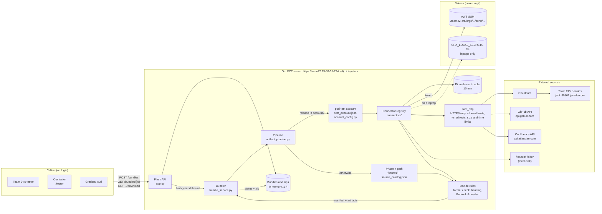
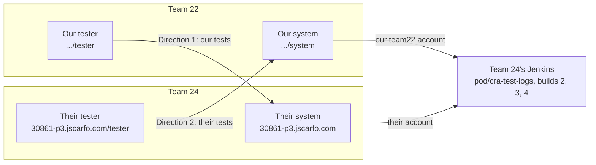

# Phase 5: how the system works, and cross-team testing with Team 24

**Branch:** `feature/jenkins-connector` (targets `person3-bounded-memory`). **Checked:** 2026-11-19.

This guide explains how a bundle request becomes a manifest and a zip now that releases can pull files from Jenkins, GitHub and Confluence. It then covers how cross-team testing works, what we still have to do before a test window, and what Team 24 needs to do. The part for Team 24 is a separate document you can send as is: [TEAM24_PHASE5_CROSSTEAM.md](TEAM24_PHASE5_CROSSTEAM.md).

The diagrams are Mermaid. They render on GitHub, and in VS Code with the "Markdown Preview Mermaid Support" extension.

---

## 1. The short version

Anyone can call `POST /bundles` with a `product_id` and `release_version`; there's no login. The service then works out where that release's four documents (SBOM, Risk Assessment, Test Logs, User Instructions) come from:

- **Releases defined in `test_account.json`** (the "pod-test" account) are fetched through **connectors**. Each category is pinned to exactly one file in one source: a Jenkins build, a GitHub commit, a Confluence attachment version, or our `fixtures/` folder.
- **Every other release** works as it did in Phase 4: read from `fixtures/<product>/<release>/`, with `source_catalog.json` able to point one category at GitHub.

Either way, the bytes go through the same rules, which give each category a status: PRESENT, MISSING, INVALID or INACCESSIBLE. The bundler then writes the manifest and a zip of the PRESENT files, byte for byte. If one source fails, only that category is INACCESSIBLE and the rest of the bundle still completes.

---

## 2. System diagram



---

## 3. One request, step by step

```mermaid
sequenceDiagram
    participant C as Caller
    participant A as API (app.py)
    participant B as Bundler
    participant P as Pipeline
    participant K as Connector (e.g. Jenkins)
    participant J as Jenkins

    C->>A: POST /bundles {product_id: prd-88, release_version: v1.5-jenkins}
    A-->>C: 202 {bundle_id, status: PENDING}
    A->>B: process in the background
    B->>P: retrieve_and_classify
    P->>P: v1.5-jenkins is in test_account.json, so use its four pins
    loop each category
        P->>K: fetch(pin), 20 s and 8 MiB shared by the whole bundle
        K->>J: GET .../pod/job/cra-test-logs/2/api/json (artifact list)
        K->>J: GET .../2/artifact/artifacts/prd-88/v1.5-jenkins/test_logs.md
        K-->>P: RETRIEVED, the bytes, version pod/cra-test-logs build 2
        P->>P: decide: valid UTF-8? first heading says "Test Logs"? gives PRESENT
    end
    P-->>B: manifest + PRESENT artifacts
    B->>B: COMPLETED if all four are PRESENT, else PARTIAL_SUCCESS; build the zip
    C->>A: GET /bundles/{id} (poll)
    A-->>C: 200 {status, manifest, download_url}
    C->>A: GET /bundles/{id}/download
    A-->>C: zip: the four files, unchanged, plus manifest.json
```

1. **Intake** (`app.py`). It checks that `product_id` and `release_version` are non-empty strings, answers 202 PENDING at once, and processes the bundle on a background thread.
2. **Choose the source** (`artifact_pipeline.retrieve_and_classify`). If `test_account.json` defines the release (or has a product-wide rule for that product), each category's pin is used. Otherwise the Phase 4 path runs. A release that exists in neither is FAILED: "No documents found".
3. **Fetch** (`connectors/`). Each pin names a connection (which source, plus its address) and a reference (which exact file). The connector fetches the original bytes through `safe_http`, which only allows HTTPS to that connection's own host, never follows redirects, and enforces time and size limits. A connector never raises an error; it always returns one of five outcomes (§5).
4. **Decide** (the same rules as Phase 4). An unsupported format, invalid UTF-8 or an empty file gives INVALID. A first heading that names the category gives PRESENT. Without that heading, Bedrock is asked which category it is, if Bedrock is switched on.
5. **Bundle** (`bundle_service.py`). The status is COMPLETED only if all four categories are PRESENT. The zip holds every PRESENT file under its own name, plus `manifest.json`. If two files share a name, the second goes in a folder named for its category (`test-logs/report.md`), so nothing is overwritten.
6. **Read back.** `GET /bundles/{id}` gives the status, manifest and `download_url`. Bundles live in memory for an hour, and a restart or deploy clears them.

---

## 4. Where each release's files come from

### 4.0 Why `test_account.json` exists

The connector kit Person 3 built is designed for **companies**. Each company logs in, adds its own connections ("our Jenkins at this address, with this token"), and pins, per release, which file each category comes from. All of that lives in a database (DynamoDB), entered through web pages. **None of those pages or logins exist yet**, and the pod's API has no logins anyway: when Team 24's tester or a grader calls `POST /bundles`, there's no company to look settings up for.

`test_account.json` fills that gap. It's one fixed, built-in company, called **pod-test**, written as a file in git instead of database rows. Every `POST /bundles` checks it first. It has the same shape as the database records (connections, products, release pins), so when logins arrive the same pipeline code reads a real company's records instead, and this file becomes that company's starting data.

**What it's for:**
- **Cross-team testing (the main reason).** It defines the three shared releases (`v1.5-jenkins`, `-missing`, `-empty`) whose Test Logs come from Team 24's Jenkins. Without it, those releases don't exist on our system and both testers would get FAILED.
- **Showing Phase 5 works.** `v1.6-all-sources` pulls from all four sources in one bundle, for graders and our own testing.
- **Pinning.** It records the exact build, commit and attachment version, so every run gets the same bytes (AC-07). The file is reviewed in git like code.

**What about DynamoDB?** Person 3's AWS setup script can create a DynamoDB table (`team22-cra-tenants`) and Cognito logins for the future company accounts. **Nothing in the running app uses them yet**: no company sign-up or connection pages exist. If they're built later, a company's records live in DynamoDB and `test_account.json` stays the built-in pod-test company. Tokens are never in DynamoDB either way; they're in SSM.

**What it is not:** a place for secrets. It holds addresses and ids only. A `token` field is refused, and tokens live in SSM (§6).

**Do you need to fill anything in?**

| Item | Needed? |
|---|---|
| Jenkins connection and the three shared releases | **Done.** Nothing to fill in |
| Confluence `email` (`replace-with-token-owner@example.invalid`) | Only for `v1.6-all-sources`. Replace it with the email of the Atlassian account that owns the Confluence token (wood297's) |
| GitHub | Done. Only the token is missing (§6) |
| New shared releases later | Add an entry under `products.prd-88.releases` and commit the matching bytes to `tests/fixtures/<type>/`. The tests check every pin has a copy |

**Don't change** `org_id` or the connection ids once tokens are stored: they're part of each token's SSM path, so changing one means storing that token again.

### 4.1 The pod-test account (`test_account.json`)

| Release (`prd-88`) | SBOM | Risk Assessment | Test Logs | User Instructions | Expected bundle |
|---|---|---|---|---|---|
| `v1.5-jenkins` | fixtures `v1.2/sbom.md` | fixtures `v1.2/risk_assessment.md` | **Jenkins** `pod/cra-test-logs` **#2** | fixtures `v1.2/user_instructions.md` | COMPLETED |
| `v1.5-jenkins-missing` | same | same | **Jenkins #3** (archived nothing) → INACCESSIBLE | same | PARTIAL_SUCCESS |
| `v1.5-jenkins-empty` | same | same | **Jenkins #4** (0-byte file) → INVALID | same | PARTIAL_SUCCESS |
| `v1.6-all-sources` | **GitHub** `cra-artifact-test@f6d381d` `sbom.json` | **Confluence** page 622599, `risk_assessment.md` v1 | **Jenkins #2** | **GitHub** `user_instructions.md` | COMPLETED once tokens are set |

The Jenkins file path is `artifacts/prd-88/<release>/test_logs.md` in each build. Builds #2–#4 are marked "Keep this build forever". The `v1.6-all-sources` release is our own showcase, not a shared pod case.

### 4.2 Everything else (unchanged since Phase 4)

`prd-88` `v1.2`, `v1.3`, `v1.4`, `v2.0` and `v1.2-github-inaccessible` still come from `fixtures/` (plus the GitHub catalog entry for the last one). They behave exactly as they did in the Phase 4 cross-team runs.

### 4.3 How `test_account.json` is laid out

```text
org_id, name: "pod-test"
connections:   { <uuid>: {type: fixtures | jenkins | github | confluence, settings: {...}} }
products:
  prd-88:
    rules:     { <category>: {conn: <uuid>, ...ref with {product}/{release}} }  applies to every release
    releases:
      v1.5-jenkins: { <category>: {conn: <uuid>, ...ref} }                      wins over a rule
```

The file is fully checked when the service starts, with the same validation a real company's connections would get. A typo stops the service at start-up instead of breaking a bundle later. Tokens can't go in it: a `token` field is refused.

---

## 5. Connectors

A connector fetches **one file for one category from one source**, and nothing else. The contract is in `connectors/base.py` and explained in `CONNECTORS.md`.

| Connector | Connection settings | What a release pins | Version reported |
|---|---|---|---|
| `fixtures` | none | `paths` under `fixtures/` | n/a |
| `jenkins` | `url`, `user`, token | `job` (folders/job), `build` (a fixed number ≥ 1), `paths` | `pod/cra-test-logs#2` |
| `github` | `repository`, token | `revision` (a 40-character SHA), `paths` | the commit SHA |
| `confluence` | `cloud_id`, `email`, token | `page_id`, `filename`, `version` | the attachment version |

**Everything is pinned.** A build number, commit SHA or attachment version always returns the same bytes, so the same request gives the same bundle (AC-07). `lastSuccessfulBuild`, branch names and "latest" are refused.

**Outcomes and what the manifest shows:**

| Connector outcome | When | Manifest status | `source_failure_detail` example |
|---|---|---|---|
| RETRIEVED | Got the original bytes | Decided by the rules: PRESENT or INVALID | (none for PRESENT) / "test_logs.md is empty" |
| NOT_FOUND | The pinned build, commit, page or file doesn't exist | INACCESSIBLE | "Jenkins build 3 of pod/cra-test-logs has none of the pinned artifact paths." |
| AUTH_FAILED | Token missing, wrong, or blocked (401/403) | INACCESSIBLE | "Jenkins rejected the connection's credentials (401)." / "Cloudflare blocked the request before it reached Jenkins (403)." |
| UNAVAILABLE | Timeout, 429, 5xx, build still running | INACCESSIBLE | "Jenkins is unavailable or rate limited (503)." |
| SOURCE_ERROR | Unusable answer: malformed listing, unexpected redirect, too large | INACCESSIBLE | "Jenkins returned an invalid build listing." |

**Rule:** a file the account *promises* (a pin) is **INACCESSIBLE** when the source can't supply it. A category with *no source configured* is **MISSING**, with `external_source: "none"`. This matches the rule both teams agreed in Phase 4 (Phase 4 doc §8, item 1).

**Caching.** RETRIEVED and NOT_FOUND answers from network sources are reused for 10 minutes, since a pinned reference can't change. Outages and credential failures are never cached, so the next bundle tries again.

**The Jenkins connector in detail.** It makes two GETs with HTTP Basic auth (user + API token) and `User-Agent: cra-documentation-service`:
1. `GET {url}/job/pod/job/cra-test-logs/{build}/api/json?tree=building,result,artifacts[relativePath]`. A 404 gives NOT_FOUND, and a running build gives UNAVAILABLE. If none of the pinned paths are listed, that's NOT_FOUND: the listing is complete, so absence is confirmed, not guessed.
2. `GET {url}/job/.../{build}/artifact/{path}` returns the raw bytes.

A build whose result is FAILURE but which archived the file is still RETRIEVED: we collect evidence, we don't judge test results.

---

## 6. Tokens: what Person 3 needs to do

### 6.1 Which tokens, and which are required

The server needs one token per external connection in `test_account.json`. **Only the Jenkins token is needed for cross-team testing.** GitHub and Confluence only feed our own showcase release, `v1.6-all-sources`.

| Token | Needed for | Required? | Who makes it | How |
|---|---|---|---|---|
| **Jenkins** API token for user `team22` | Test Logs in the three shared `v1.5-jenkins*` releases, and in `v1.6-all-sources` | **Yes: cross-team testing depends on it** | You (anyone with the `team22` login) | Log in at `https://jenk-30861.jscarfo.com` as `team22` → your name (top right) → **Security** → **API Token** → **Add new token**, name it `cra-service`, **Generate**. Copy it straight away: Jenkins shows it only once |
| GitHub fine-grained token | SBOM and User Instructions in `v1.6-all-sources` | Optional | Anyone with a GitHub account | GitHub → Settings → Developer settings → Fine-grained tokens → Generate. Repository access: **Public repositories (read-only)** (`cra-artifact-test` is public). No other permissions. Pick an expiry after the course ends |
| Confluence scoped API token | Risk Assessment in `v1.6-all-sources` | Optional | wood297 (owns the Confluence test page) | Atlassian account → Security → API tokens → create a **scoped** token with `read:attachment:confluence`. **Also** put that Atlassian account's email in `test_account.json` in place of `replace-with-token-owner@example.invalid` |

Without the optional two, `v1.6-all-sources` is PARTIAL_SUCCESS (SBOM, Risk Assessment and User Instructions INACCESSIBLE: "…has no token"). Nothing else is affected.

The Phase 4 release `v1.2-github-inaccessible` doesn't use any of these: it still goes through `source_catalog.json` and reads GitHub anonymously, as before.

### 6.2 Getting the token to Person 3

Send the Jenkins token **privately**: a direct message or a password manager, never the team channel, git, an issue or a screenshot. Once it's stored, delete the message. Anyone with the token can read and create jobs as `team22` on Team 24's server.

Alternatively, if you have the team's AWS access, store it yourself with step 6.3 and never send it to anyone.

### 6.3 Storing it (Person 3, on a laptop signed in to AWS)

Run these from the repository root, on this branch (or `main` once merged). The script reads the parameter path from `test_account.json` and asks for the token without echoing it:

```bash
deploy/put_connection_token.sh jenkins       # paste the token at the hidden prompt
deploy/put_connection_token.sh status        # check: jenkins should say "stored"
# optional, for v1.6-all-sources:
deploy/put_connection_token.sh github
deploy/put_connection_token.sh confluence
```

This stores an SSM **SecureString** in `us-east-2`:

| Connection | SSM parameter |
|---|---|
| Jenkins | `/team22-cra/orgs/30653a13-cd0f-418c-8ec3-a8f813be7dbc/conn/29b9f99b-52d3-4ef2-acbb-475d8a4f239f` |
| GitHub | `/team22-cra/orgs/30653a13-cd0f-418c-8ec3-a8f813be7dbc/conn/2d787751-e9dd-439a-ad10-e33c9257b10d` |
| Confluence | `/team22-cra/orgs/30653a13-cd0f-418c-8ec3-a8f813be7dbc/conn/022f2e41-fa54-450c-8354-6ac0fd30f428` |

Nothing is copied onto the EC2 server and nothing needs restarting: the app reads the parameter on each bundle. The token can be stored before this branch is deployed; it's simply unused until then.

### 6.4 Letting the server read it

The server's instance role (`team22-cra-instance`) has AWS's `AmazonSSMManagedInstanceCore` policy, which, as far as we know, already allows `ssm:GetParameter`. The parameter uses the default `aws/ssm` key, which needs no extra KMS permission. So this step is probably unnecessary, but step 6.5 confirms it. If 6.5 reports AccessDenied in the server log, run:

```bash
deploy/put_connection_token.sh grant-read    # lets the role read /team22-cra/orgs/* only
```

Running `deploy/aws_tenant_setup.sh prod` also grants this, along with the Cognito and DynamoDB pieces, which this feature doesn't need.

### 6.5 Checking it from the server (after this branch is on `main` and deployed)

On EC2 (via SSH or SSM Session Manager):

```bash
cd /home/ubuntu/cra/current
set -a; . deploy/cra.env; set +a          # sets CRA_SECRET_PREFIX=/team22-cra and AWS_REGION
.venv/bin/python -m connectors.account_live_check --type jenkins
```

Expect four JSON lines with `"ok": true` and `4/4 pins match`. This also settles the Cloudflare question from the EC2 address:

| What you see | Meaning | Fix |
|---|---|---|
| `4/4 pins match` | Token, SSM access and Cloudflare all work | Nothing |
| `"no stored API token"` | The parameter is missing, or the role can't read it | Step 6.3, then 6.4 (`grant-read`) |
| `"rejected the connection's credentials (401)"` | Wrong or revoked token | Make a new token; store it again with 6.3 |
| `"Cloudflare blocked the request before it reached Jenkins (403)"` | Cloudflare blocks the EC2 address | Send Team 24 `docs/TEAM24_CLOUDFLARE_ALLOWLIST.md` |

### 6.6 Rotating or revoking

Make a new token in Jenkins, store it with `deploy/put_connection_token.sh jenkins` (this overwrites the old one), then revoke the old token in Jenkins. No restart is needed. If a token leaks, revoke it in Jenkins first.

### 6.7 On a laptop and in CI

- **Laptop:** `CRA_LOCAL_SECRETS=<file>`, a chmod 600 JSON file `{"connections": {"<connection id>": "<token>"}}`, outside the repository.
- **CI and pytest:** no tokens. Tests serve the committed copies in `tests/fixtures/<type>/`.

Tokens never appear in manifests, logs or error details: the connector kit masks them, and the tests check this.

---

## 7. What happens when something breaks

| Situation | Bundle | The affected category | The other categories |
|---|---|---|---|
| Jenkins down, or Cloudflare blocks us | PARTIAL_SUCCESS | Test Logs INACCESSIBLE, retried on the next request | PRESENT, in the zip |
| Pinned build deleted, or file not archived | PARTIAL_SUCCESS | INACCESSIBLE ("not found") | PRESENT |
| Token missing or revoked | PARTIAL_SUCCESS | INACCESSIBLE ("no stored API token" / "rejected… (401)") | PRESENT |
| Archived file is empty | PARTIAL_SUCCESS | INVALID ("test_logs.md is empty"), not in the zip | PRESENT |
| `test_account.json` is malformed | The service doesn't start, and the deploy smoke test fails | n/a | n/a |
| Release unknown everywhere | FAILED, "No documents found…" | n/a | n/a |

---

## 8. Running and checking it

| What | Command |
|---|---|
| All tests (offline, as CI runs them) | `.venv/bin/pytest -q` |
| CI's other checks | `.venv/bin/ruff check .` · `.venv/bin/mypy --ignore-missing-imports .` · `.venv/bin/bandit -q -r . -x ./tests,./.venv` |
| One live fetch | `CRA_LOCAL_SECRETS=<file> python -m connectors.try_fetch <connection.json> --product prd-88 --release v1.5-jenkins` |
| **Check every pinned file against its committed copy (run before every test window)** | `CRA_LOCAL_SECRETS=<file> python -m connectors.account_live_check --type jenkins`, which prints one JSON line per pin and exits 0 if all match |
| The same on EC2 | `CRA_SECRET_PREFIX=/team22-cra python -m connectors.account_live_check` |
| **Check a deployed system against `spec.yaml`** (every operation's responses against the schemas, and every shared release's statuses and bytes) | `python -m test_runner.spec_check --url https://team22.13-58-35-224.sslip.io/system`. Exits 0 only if every check passes |
| A full local bundle against the real Jenkins | `CRA_LOCAL_SECRETS=<file> python app.py`, then `POST /bundles` |

**Verified 2026-11-19 from a laptop, against the real Jenkins:** all four Jenkins pins match their sha256. Real bundles for the three `v1.5-jenkins*` releases came out COMPLETED, PARTIAL_SUCCESS (INACCESSIBLE) and PARTIAL_SUCCESS (INVALID).

---

## 9. Cross-team testing: how it works

### 9.1 The setup

Each team runs **two services**: the *system* (the bundle API) and a *tester* (a service that runs the pod's acceptance suite against any system URL). Cross-team testing means each team's tester runs against the other team's system, in both directions:



1. **A tester never reads Jenkins itself.** It asks a system for a bundle and compares the answer with its **oracle** (`test_runner/oracle.json`): the expected status of every category, written down before any system runs.
2. **Content is checked by sha256.** The tester downloads the zip and checks that each expected file's exact bytes are in it. Our tester reads the expected bytes from `fixtures/<product>/<release>/<file>`. So **both systems must serve byte-identical files** for every shared release.
3. **Run it.** `POST {tester}/test/setup {"target_url": ...}` gives a session; then `POST {tester}/test/run {"session_id": ...}` returns a report of pass / fail / error / skip per criterion (API-01…07, AC-01…08). Phase 4 doc §3–§4 has the exact calls.

### 9.2 What changes for Phase 5

**For cross-team testing, nothing.** Each team builds its own system however it likes; the testers only compare answers for the shared releases. The Phase 4 shared releases (`v1.2`, `v1.3`, `v1.4`, `v2.0`, `v1.2-github-inaccessible` for AC-05, `v0.0-does-not-exist`) are unchanged on our side and passed both ways on 2026-11-01. The one new spec item is `coverage.model`, which our tester now adds only for our own system (`docs/DESIGN_REQUIREMENTS_MAPPING.md`).

**Proposed spec change (`spec.yaml` 1.4.0):** the three Jenkins releases (`v1.5-jenkins`, `-missing`, `-empty`) become shared cases for AC-06, AC-05 and AC-04 (Team 24 doc §4). Once Team 24 agrees, both testers add them, and the date and channel of the agreement go in the Phase 5 report, Q3.2.

### 9.3 Our to-do list before a test window

| # | Step | Status |
|---|---|---|
| 1 | Jenkins builds #2–#4 exist, kept forever, bytes match | **Done** |
| 2 | Connectors, pipeline, bundler and `coverage.model` | **Done** (this branch) |
| 3 | Commit, then merge: this branch → `person3-bounded-memory` → `main`. Only `main` deploys to EC2 | To do |
| 4 | Jenkins token into SSM (§6) | To do |
| 5 | Check the deployed system: Phase 4 releases unchanged, `v1.5-jenkins` COMPLETED (this also shows whether Cloudflare lets the EC2 address through) | To do |
| 6 | Send Team 24 `TEAM24_PHASE5_CROSSTEAM.md`; get their registry details, a window, and a yes or no on the optional Jenkins cases | To do |
| 7 | Only if they said yes: add the three Jenkins releases to our tester (expected bytes in `fixtures/prd-88/v1.5-jenkins*/`, entries in `oracle.json`, one new check) | Optional |
| 8 | Own-team run: our tester → our deployed system. The report must show `coverage.model` 8/8 | To do |
| 9 | Window: commit `deploy/PAUSED`, run both directions, save the JSON reports in `docs/crossteam-<date>/`, and write up the results as in Phase 4 | To do |

---

## 10. What to tell Team 24

Send **[TEAM24_PHASE5_CROSSTEAM.md](TEAM24_PHASE5_CROSSTEAM.md)**. It says:
- nothing they rely on has changed
- what we set up on their Jenkins, and what to leave alone
- what we built, in brief
- the optional shared Jenkins cases
- what we need from them

---

## 11. Known gaps

- **Not deployed yet.** The EC2 server runs `main`. Until this branch is merged and the token is in SSM, our deployed system doesn't serve the Jenkins releases correctly.
- **GitHub and Confluence haven't been tested live.** The local `GITHUB_TOKEN` is rejected (401); there's no Confluence token; and the Confluence connection in `test_account.json` still has a placeholder email. Until those are fixed, `v1.6-all-sources` is PARTIAL_SUCCESS. Neither is part of the shared pod cases.
- **The tester doesn't check the Jenkins releases yet** (§9.3, steps 6–8).
- **Cloudflare has only been tested from a laptop**, not from the EC2 address.
